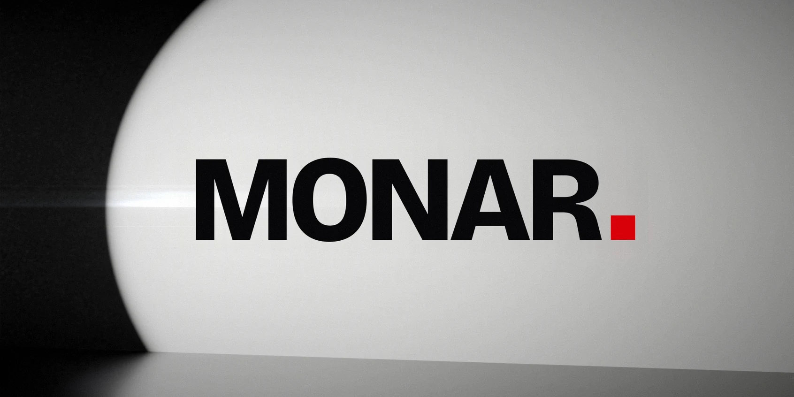

<picture><source media="(prefers-color-scheme: dark) and (max-width: 600px)" srcset="assets/services-v3-phone-dark.svg"><source media="(max-width: 600px)" srcset="assets/services-v3-phone-light.svg"><source media="(prefers-color-scheme: dark)" srcset="assets/services-v3-dark.svg"></picture>

<a href="https://www.monarservices.org/"><picture><source media="(prefers-color-scheme: dark)" srcset="assets/badge-website-v3-dark.svg"></picture></a>
<a href="https://github.com/Monar-HQ/evermind/discussions"><picture><source media="(prefers-color-scheme: dark)" srcset="assets/badge-discussions-v3-dark.svg"></picture></a>

<picture><source media="(prefers-color-scheme: dark) and (max-width: 600px)" srcset="assets/header-drops-v3-phone-dark.svg"><source media="(max-width: 600px)" srcset="assets/header-drops-v3-phone-light.svg"><source media="(prefers-color-scheme: dark)" srcset="assets/header-drops-v3-dark.svg"></picture>

<!-- drops:start -->
<!-- pairing rule (generated from drops.json by org_build_v3.py): an odd number of LIVE drops -> the Next card fills the last pair; an even number -> the Next drop becomes one full-width 846x120 strip. -->

<a href="https://github.com/Monar-HQ/evermind"><picture><source media="(prefers-color-scheme: dark) and (max-width: 600px)" srcset="assets/drop-evermind-v3-phone-dark.svg"><source media="(max-width: 600px)" srcset="assets/drop-evermind-v3-phone-light.svg"><source media="(prefers-color-scheme: dark)" srcset="assets/drop-evermind-v3-dark.svg"></picture></a><a href="https://github.com/orgs/Monar-HQ/discussions"><picture><source media="(prefers-color-scheme: dark) and (max-width: 600px)" srcset="assets/drop-next-v3-phone-dark.svg"><source media="(max-width: 600px)" srcset="assets/drop-next-v3-phone-light.svg"><source media="(prefers-color-scheme: dark)" srcset="assets/drop-next-v3-dark.svg"></picture></a>

<!-- drops:end -->

<picture><source media="(prefers-color-scheme: dark) and (max-width: 600px)" srcset="assets/footer-v3-phone-dark.svg"><source media="(max-width: 600px)" srcset="assets/footer-v3-phone-light.svg"><source media="(prefers-color-scheme: dark)" srcset="assets/footer-v3-dark.svg"></picture>
